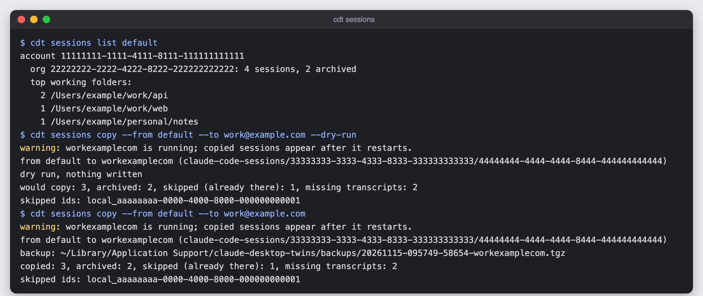

# Multiple Claude Desktop accounts on one Mac

**Use your work and personal Claude accounts at the same time, without signing out.**
`claude-desktop-twins` (command `cdt`) turns each Claude account into its own Mac app,
with its own Dock icon, Cmd-Tab entry and notifications. Click a notification and the
right account opens.

- Keep work and personal accounts signed in side by side.
- Switch accounts with Cmd-Tab, the Dock or Spotlight.
- Get notifications per account, and turn them on or off per account.
- Move Claude Code sessions between accounts with [Premium](#premium).

🇻🇳 **Tiếng Việt:** dùng nhiều tài khoản Claude Desktop cùng lúc trên một máy Mac, không
cần đăng xuất. Xem [hướng dẫn tiếng Việt](#hướng-dẫn-tiếng-việt).

[](https://github.com/dakiquang/claude-desktop-twins/releases)
[](https://github.com/dakiquang/claude-desktop-twins/actions/workflows/ci.yml)
[](LICENSE)

[](https://github.com/dakiquang/homebrew-tap)

### ☕ Found it useful? Buy me a coffee

If this tool saves you from signing in and out every day, a coffee keeps it maintained.
Any amount helps. More options on the [donate page](https://dakiquang.github.io/donate/).

| MoMo · VietQR | PayPal |
|:---:|:---:|
|  |  |
| [](https://me.momo.vn/dakiquang) | [](https://paypal.me/dakiquang) |

## Quick start

```bash
brew install dakiquang/tap/claude-desktop-twins
cdt add work@example.com
cdt add personal@example.com
cdt open work
```

Each `cdt add` creates an app in `~/Applications/Claude Desktop Twins/` and asks macOS
for notification permission. Open each app once and sign in to its account.


Requirements: macOS 12 or later, Claude Desktop in `/Applications`, and the Xcode
Command Line Tools (`xcode-select --install`) to build a small helper.

Unofficial. Not affiliated with Anthropic. Tested with Claude Desktop 5.11492.5 on macOS
(Apple silicon), November 2026.

## Why Claude Desktop needs this

Claude Desktop signs in to one account at a time. To use another account you sign out
and sign in again.

You can start a second copy on another data folder with `--user-data-dir`. But every
copy keeps the same app identity, so macOS treats them as one app. They share one Dock
icon and one notification setting, and a notification click opens whichever copy macOS
picks, not the one that sent it.

`claude-desktop-twins` gives each account its own app identity, so macOS keeps them
apart.

## Usage

### Open and list accounts

```bash
cdt open work        # open it, or bring it forward if it already runs
cdt                  # pick an account from a menu
cdt list             # accounts, running state, versions
cdt doctor           # check everything
```

The apps also work from the Dock and Spotlight.


`cdt doctor` checks Claude.app, the helper, and each account's signature, version,
update block, notification permission and running state:


### After a Claude Desktop update

Open the original Claude.app once so it installs the update. Then rebuild each account
that `cdt list` marks as stale:

```bash
cdt rebuild work@example.com
```

### See Claude Code sessions per account

`default` is plain Claude.app. `default` and `premium` are reserved and cannot be
account names.

```bash
cdt sessions list default
cdt sessions list work --json
```



Copying sessions from one account to another is part of [Premium](#premium).

### Import an existing profile

Adopt a data folder made by another launcher or by hand. The data folder of plain
Claude.app cannot be imported: add an account instead.

```bash
cdt import ~/Library/Application\ Support/SomeOtherLauncher/work --as work@example.com
```

### Give an account its own icon

```bash
cdt icon set work@example.com ~/Pictures/work.icns   # shown in the Dock and Cmd-Tab
cdt icon reset work@example.com                      # back to Claude's icon
```

The account must not be running. The icon is kept across rebuilds.

### Use from scripts

`cdt list --json`, `cdt doctor --json` and `cdt sessions list <account> --json` print
JSON with a `schema` number, for scripts and other tools.

### Remove accounts or uninstall

```bash
cdt remove personal@example.com             # keeps its data folder
cdt remove personal@example.com --purge     # also moves the data folder to the Trash
cdt uninstall                               # all apps, the helper and the registry
cdt uninstall --purge-data                  # also data folders and session backups
brew uninstall claude-desktop-twins
```

Commands that change or delete things (`rebuild`, `remove`, `icon`) need the full
account name. `open` and `sessions list` accept part of it.

## Premium

Claude Desktop Twins Premium is a menu bar app for the same accounts: $9.99 once, up to
3 Macs, a 5-day free trial and a 14-day refund. It uses the accounts you made with `cdt`;
the free CLI stays MIT and keeps everything above. Nothing in the CLI depends on it.

- **Switch from the menu bar** in one click or with ⌥1…⌥9.
- **One-click update** of every account after a Claude update, asking before it stops
  a running Claude Code session.
- **Plan limits per account**: the 5-hour and weekly limits left, from Claude Code on your
  Mac (opt-in; each refresh sends one tiny request through your own Claude Code, which uses
  a little of the limit).
- **Claude Code usage per account**: tokens and an estimated cost for today and the last
  7 days, and the tokens of the current 5-hour block, counted on your Mac.
- **Move Claude Code sessions** between accounts, with a backup first, nothing overwritten
  and archived sessions kept archived.
- Dock icons, health checks with fixes and adding or removing accounts from a window.

No telemetry; it reads no claude.ai tokens. [Get Premium](https://claudedesktoptwins.com/).
Already using `cdt sessions copy` from v0.1.0? That version keeps working; it stays
available under the MIT licence.

## How it works

`cdt add` makes an APFS clone of `/Applications/Claude.app`. The clone shares disk
blocks with the original, so it takes almost no extra space. Then it changes a few
things in the copy:

- a bundle id of its own, `local.claude-desktop-twins.<account>`, and a display name;
- a small launcher that starts Claude with `--user-data-dir` pointing at the account's
  folder under `~/Library/Application Support/claude-desktop-twins/profiles/`;
- an ad-hoc signature whose signing identifier equals the new bundle id, which macOS
  requires before it lets an app post notifications;
- Claude's own "Block auto-updates" setting, written to the account's
  `<data folder>-3p/configLibrary/` and nowhere else, so the copy never replaces itself
  while the original Claude.app keeps updating. If that folder already exists (it can
  hold a third-party inference setup), it is left alone and `cdt doctor` says so;
- a helper, `cdt-helper`, that asks macOS for notification permission on the app's
  behalf (Claude never asks by itself) and brings a running account forward without
  needing Automation permission.

The `claude://` link handler and Anthropic's provisioning profile are removed from the
copy. No Anthropic file is shipped with this tool: every clone is made on your Mac from
the Claude.app you installed.

`cdt open` never starts a second instance on a data folder that is in use. It looks for
a running Claude process on that folder and brings it forward instead.

## Limits

- Passkeys and the Secure Enclave device key do not work in the clones. They are tied
  to Anthropic's signature, which the clone no longer has.
- macOS asks for keychain access again after each rebuild, because the signature
  changes.
- Clones do not update themselves. Open the original Claude.app to update it, then run
  `cdt rebuild <account>` for each account `cdt list` marks as stale. A stale account
  keeps working on its older version until you rebuild it.
- The Code tab in every account shares `~/.claude`, `~/.claude.json` and the Claude
  Code keychain item. Settings, skills and transcripts are shared, and some account
  details from one account can show up in another.
- macOS only.

If Claude Desktop ships its own multi-account support, `cdt doctor` will say so, and
you may not need this tool any more.

## Alternatives

Other free tools clone Claude.app too, but keep Anthropic's bundle id and signature, for
example [claude-desktop-profiles](https://github.com/odahcam/claude-desktop-profiles)
and [claude-multiprofile](https://github.com/jmdarre-v/claude-multiprofile). The table
compares the two designs; the right-hand column comes from those projects' READMEs, not
from testing them.

| | claude-desktop-twins | Clones that keep Claude's identity |
|---|---|---|
| Notification click opens the right account | Yes | Not by design: every copy is the same app to macOS |
| Notification settings per account | Yes | Shared |
| Own Dock icon and Cmd-Tab entry | Yes | Yes, as separate copies, often with tinted icons |
| Picks up Claude updates | Run `cdt rebuild <account>` after each update | Automatically (self-update, or a rebuild at launch) |
| Passkeys and device key | No | Yes |
| Runtime | Bash, plus a small Swift helper built on your Mac | Swift app, or Node.js CLI |

Both approaches are valid. This one picks correct notifications over automatic updates.

## FAQ

### How do I use two Claude accounts on one Mac at the same time?

Install the tool, then run `cdt add` once per account, for example
`cdt add work@example.com` and `cdt add personal@example.com`. Each account gets its own
app in `~/Applications/Claude Desktop Twins/`. Open both and sign in once in each.

### Can I switch Claude Desktop accounts without signing out?

Yes. Every account stays signed in inside its own app, so you switch with Cmd-Tab, the
Dock, Spotlight, `cdt open <account>` or the `cdt` menu.

### Do notifications go to the right account?

Yes. Each app has its own bundle id, so macOS shows which account a notification came
from, and clicking it opens that account. You can turn notifications on or off per
account in System Settings.

### Does it change my Claude.app?

No. `/Applications/Claude.app` is never modified and keeps updating itself. The
per-account apps are copies made on your Mac. No Anthropic file is shipped with this
tool.

### Are my accounts kept separate?

Each account has its own data folder, so sign-ins, cookies and chats stay apart. The
Code tab is the exception: all accounts share `~/.claude` (settings, skills and
transcripts). See [Limits](#limits).

### What happens when Claude Desktop updates?

Open the original Claude.app so it installs the update, then run
`cdt rebuild <account>` for each account that `cdt list` marks as stale. Until then the
account keeps working on its older version.

### Does it work on Windows or Linux?

No. It relies on macOS app bundles, code signing and APFS clones.

## Hướng dẫn tiếng Việt

**Chạy nhiều tài khoản Claude Desktop trên một máy Mac**, ví dụ tài khoản công ty và tài
khoản cá nhân, mở cùng lúc mà không phải đăng xuất rồi đăng nhập lại. Mỗi tài khoản trở
thành một app riêng, có icon riêng trên Dock, mục riêng trong Cmd-Tab và thông báo riêng.
Bấm vào thông báo là mở đúng tài khoản đã gửi nó.

### Cài đặt và dùng nhanh

```bash
brew install dakiquang/tap/claude-desktop-twins
cdt add work@example.com
cdt add personal@example.com
cdt open work
```

Mỗi lệnh `cdt add` tạo một app trong `~/Applications/Claude Desktop Twins/` và xin quyền
gửi thông báo (chọn Allow). Mở từng app một lần và đăng nhập đúng tài khoản. Cần macOS 12
trở lên, Claude Desktop trong `/Applications` và Xcode Command Line Tools
(`xcode-select --install`).

Chuyển session Claude Code giữa các tài khoản có trong bản [Premium](#premium).

### Câu hỏi thường gặp

**Làm sao dùng 2 tài khoản Claude trên 1 máy Mac cùng lúc?**
Chạy `cdt add` cho từng tài khoản. Mỗi tài khoản có app riêng; mở cả hai và đăng nhập một
lần ở mỗi app.

**Có đổi tài khoản Claude mà không cần đăng xuất không?**
Có. Mỗi tài khoản luôn đăng nhập trong app của nó, bạn chuyển qua lại bằng Cmd-Tab,
Dock, Spotlight hoặc `cdt open <tài khoản>`.

**Có sửa Claude.app gốc không?**
Không. Claude.app gốc giữ nguyên và vẫn tự cập nhật. Các app theo tài khoản là bản sao tạo
ngay trên máy bạn.

**Khi Claude Desktop cập nhật thì làm gì?**
Mở Claude.app gốc một lần để nó cập nhật, rồi chạy `cdt rebuild <tài khoản>` cho từng tài
khoản mà `cdt list` báo là cũ (stale).

**Dữ liệu các tài khoản có tách riêng không?**
Có: đăng nhập, cookie và lịch sử chat nằm ở thư mục riêng của từng tài khoản. Riêng tab
Code dùng chung `~/.claude` (cài đặt, skill, transcript). Xem mục [Limits](#limits).

**Có chạy trên Windows hay Linux không?**
Không, chỉ macOS.

Thấy hữu ích thì [mời mình một ly cà phê](#-found-it-useful-buy-me-a-coffee) qua MoMo,
VietQR hoặc PayPal nhé.

## Contributing and support

Bug reports and pull requests are welcome in
[Issues](https://github.com/dakiquang/claude-desktop-twins/issues). Report security
issues privately as described in [SECURITY.md](SECURITY.md). If the tool helps you, you
can also [buy me a coffee](https://dakiquang.github.io/donate/).

## Disclaimer

Unofficial personal project, not affiliated with or endorsed by Anthropic. "Claude" is
used only to describe what the tool works with. It is not connected to any company or
employer, and comes with no promise of support. Use it at your own risk.

## License

MIT. See [LICENSE](LICENSE). Made by [Quang Dang (@dakiquang)](https://github.com/dakiquang).
