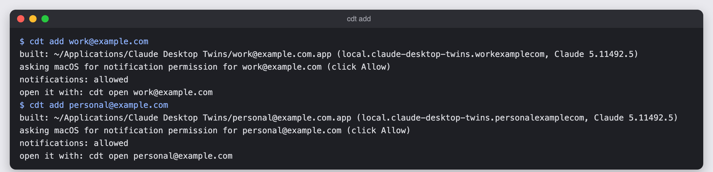
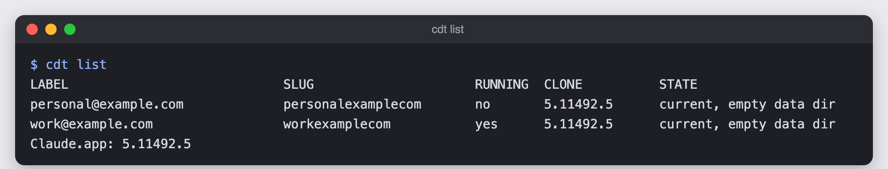
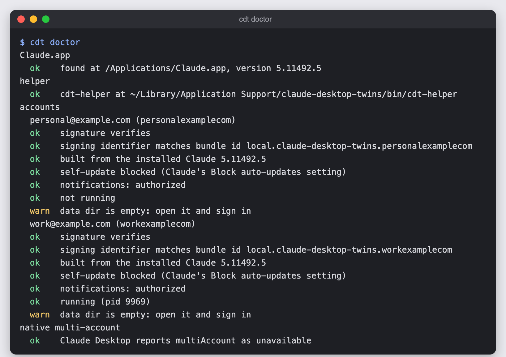

# claude-desktop-twins: multiple Claude Desktop accounts on one Mac

**Run your work and personal Claude Desktop accounts side by side on macOS.** Each
account becomes its own app, with its own Dock icon, Cmd-Tab entry and notifications,
and clicking a notification opens the account that sent it. No more signing out and in
to switch accounts.

[](https://github.com/dakiquang/claude-desktop-twins/releases)
[](https://github.com/dakiquang/claude-desktop-twins/actions/workflows/ci.yml)
[](LICENSE)

[](https://github.com/dakiquang/homebrew-tap)

[](https://paypal.me/dakiquang)
[](https://me.momo.vn/dakiquang)
[](#support)

```bash
brew install dakiquang/tap/claude-desktop-twins
```

Unofficial. Not affiliated with Anthropic.



## The problem

Claude Desktop signs in to one account at a time. You can start a second copy on a
different data folder with `--user-data-dir`, but every copy still uses the same app
identity. macOS then treats all copies as one app: they share one Dock icon, one
notification setting, and a notification click brings up whichever copy macOS picks,
not the one that sent it.

## Install

```bash
brew install dakiquang/tap/claude-desktop-twins
```

This installs the `claude-desktop-twins` command and the short alias `cdt`. It needs
macOS 12 or later, Claude Desktop in `/Applications`, and the Xcode Command Line Tools
(`xcode-select --install`) to build a small helper.

## Use

```bash
cdt add work@example.com          # create an app for the account, ask for notifications
cdt add personal@example.com
cdt open work                     # open it, or bring it forward if it already runs
cdt                               # pick an account from a menu
cdt list                          # accounts, running state, versions
cdt doctor                        # check everything
```

Sign in to the right account the first time each app opens. The apps live in
`~/Applications/Claude Desktop Twins/`, so you can also keep them in the Dock or open
them from Spotlight.



`cdt doctor` checks Claude.app, the helper, and each account's signature, version,
notification permission and running state:



After Claude Desktop updates, open the original Claude.app once so it installs the
update, then rebuild each account that `cdt list` marks as stale:

```bash
cdt rebuild work@example.com
```

Move Code sessions between accounts (the target account must have opened its Code tab
once):

```bash
cdt sessions list work
cdt sessions copy --from default --to work@example.com --cwd /projects/api --dry-run
cdt sessions copy --from default --to work@example.com --cwd /projects/api
```

Commands that change or delete things (`rebuild`, `remove`, the `--to` of `sessions copy`)
need the full account name; `open` and `sessions list` accept part of it.

`default` is plain Claude.app. A copy backs up the target first, never overwrites a
session that is already there, and keeps archived sessions archived.


Adopt a data folder made by another launcher or by hand:
(the data folder of plain Claude.app cannot be imported; add an account and copy
sessions into it instead)

```bash
cdt import ~/Library/Application\ Support/SomeOtherLauncher/work --as work@example.com
```

Remove one account, or everything:

```bash
cdt remove personal@example.com             # keeps its data folder
cdt remove personal@example.com --purge     # also moves the data folder to the Trash
cdt uninstall                               # all apps, the helper and the registry
cdt uninstall --purge-data                  # also data folders and session backups
brew uninstall claude-desktop-twins
```

## How it works

`cdt add` makes an APFS clone of `/Applications/Claude.app` (it shares disk blocks with
the original, so it takes almost no extra space) and changes a few things in the copy:

- a bundle id of its own, `local.claude-desktop-twins.<account>`, and a display name;
- a small launcher that starts Claude with `--user-data-dir` pointing at the account's
  folder under `~/Library/Application Support/claude-desktop-twins/profiles/`;
- an ad-hoc signature whose signing identifier equals the new bundle id, which macOS
  requires before it lets an app post notifications;
- Claude's own "Block auto-updates" setting, written to the account's
  `<data folder>-3p/configLibrary/` and nowhere else, so the copy never replaces itself
  while the original Claude.app keeps updating. If that folder already exists (it can
  hold a third-party inference setup), it is left alone and `cdt doctor` says so;
- a helper, `cdt-helper`, that asks macOS for notification permission on the app's
  behalf (Claude never asks by itself) and brings a running account forward without
  needing Automation permission.

The `claude://` link handler and Anthropic's provisioning profile are removed from the
copy. No Anthropic file is shipped with this tool: every clone is made on your Mac
from the Claude.app you installed.

`cdt open` never starts a second instance on a data folder that is in use. It looks for
a running Claude process on that folder and brings it forward instead.

## Limits

- Passkeys and the Secure Enclave device key do not work in the clones. They are tied
  to Anthropic's signature, which the clone no longer has.
- macOS asks for keychain access again after each rebuild, because the signature
  changes.
- Clones do not update themselves: each one has Claude's "Block auto-updates" setting
  turned on in its own configuration folder. Open the original Claude.app to update it, then run
  `cdt rebuild <account>` for each account `cdt list` marks as stale. A stale account
  keeps working on its older version until you rebuild it.
- The Code tab in every account shares `~/.claude`, `~/.claude.json` and the Claude
  Code keychain item. Settings, skills and transcripts are shared, and some account
  details from one account can show up in another. Session copying relies on this
  sharing.
- `cdt sessions copy` relies on an undocumented folder layout checked up to Claude
  5.11492.5. On a newer Claude it refuses to run unless you pass `--force`.
- macOS only.

If Claude Desktop ships its own multi-account support, `cdt doctor` will say so, and
you may not need this tool any more.

## Comparison

Other free tools clone Claude.app too, but keep Anthropic's bundle id and signature, for
example [claude-desktop-profiles](https://github.com/odahcam/claude-desktop-profiles)
and [claude-multiprofile](https://github.com/jmdarre-v/claude-multiprofile). The table
compares the two designs; the right-hand column comes from those projects' READMEs, not
from testing them.

| | This tool | Clones that keep Claude's identity |
|---|---|---|
| Notification click opens the right account | Yes | Not by design: every copy is the same app to macOS |
| Notification settings per account | Yes | Shared |
| Own Dock icon and Cmd-Tab entry | Yes | Yes, as separate copies, often with tinted icons |
| Picks up Claude updates | Run `cdt rebuild <account>` after each update | Automatically (self-update, or a rebuild at launch) |
| Passkeys and device key | No | Yes |
| Runtime | Bash, plus a small Swift helper built on your Mac | Swift app, or Node.js CLI |

Both approaches are valid. This one picks correct notifications over automatic updates.

## Support

If this tool is useful to you, buy me a coffee through one of the links below. Bug
reports and pull requests help too.

- [PayPal](https://paypal.me/dakiquang)
- [MoMo](https://me.momo.vn/dakiquang), or scan the VietQR code (Vietnam)

Nếu thấy hữu ích, mời mình một ly cà phê qua MoMo hoặc quét mã VietQR bên dưới nhé.


## Disclaimer

Unofficial personal project, not affiliated with or endorsed by Anthropic. "Claude" is
used only to describe what the tool works with. It is not connected to any company or
employer, and comes with no promise of support. Use it at your own risk.

## License

MIT. See [LICENSE](LICENSE).
